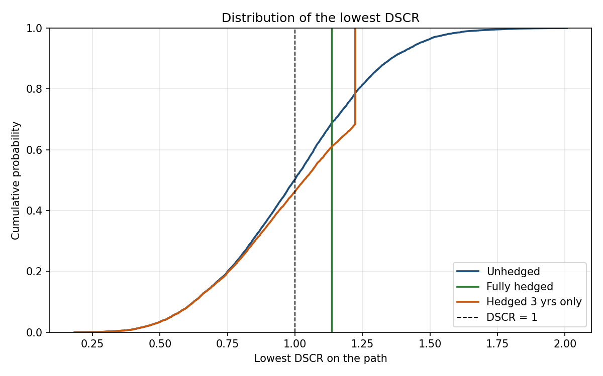
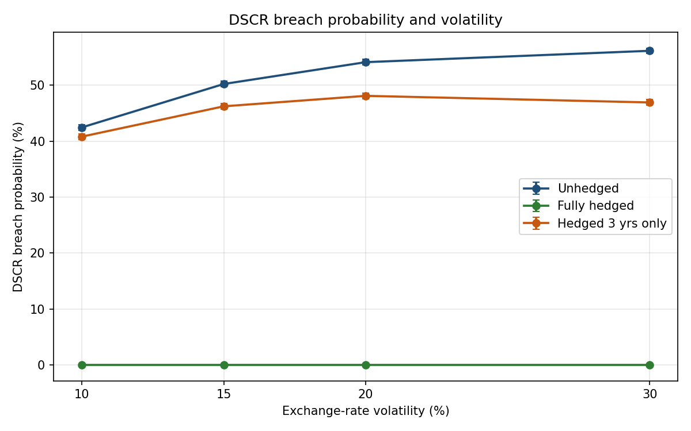

# Exchange-rate risk and DSCR

### Note

This is a short independent project. The exchange rates are simulated random draws, and the tables below illustrate the assumptions in Section 2.

Author: Yuxuan Ma

## 1. Question

DSCR is debt-service coverage ratio.

The question is how often the DSCR falls below 1 when the project earns local currency but services its debt in dollars. Hedging is the choice I change. A geometric Brownian motion generates the exchange rate, and local revenue is converted into dollars so it can be set against the dollar debt service. I look first at an open position beside a hedge held for all ten years. A hedge that stops at the end of year 3 is added afterwards, which shows what a short hedge changes.

## 2. Setup and assumptions

**Every number in the table is an assumption I chose for this exercise.** The spot rate is normalised to 1, so a later value can be read as a multiple of today's rate.

S(t) measures local currency per dollar. When S rises, the local currency has depreciated, and dollar revenue, which equals local revenue divided by S, falls.


| Parameter                  | Symbol  | Value    | Role                                     |
| -------------------------- | ------- | -------- | ---------------------------------------- |
| Initial exchange rate      | S₀      | 1.0      | Units of local currency per dollar       |
| Dollar interest rate       | r_usd   | 4%       | Continuous, used in the forward          |
| Local interest rate        | r_local | 8%       | Continuous, used in the forward          |
| Drift of the exchange rate | μ       | 4%       | Set equal to r_local − r_usd             |
| Volatility                 | σ       | 15%      | Baseline; the grid is 10%, 15%, 20%, 30% |
| Growth of local revenue    | g       | 3%       | Certain, discrete, once a year           |
| Initial DSCR               | n/a     | 1.3      | Used to back out the dollar debt service |
| Horizon                    | T       | 10 years | Annual steps                             |
| Number of paths            | N       | 10,000   |                                          |
| Random seed                | n/a     | 888888   | Same draws every run                     |


Year-1 local revenue is set to 1, and it then grows at 3% a year. Dollar debt service is flat. I set it so that converting the first year's revenue at today's spot gives a DSCR of 1.3, and the implied debt service is 1 / 1.3 ≈ 0.769 dollars a year. After debt has been scaled off that same revenue, the DSCR moves with the growth rate and with the exchange rate used in the conversion. The hedge is the part of the calculation that replaces the spot with the forward.

μ is set equal to the interest differential. The forward then matches the expected future spot, E[S(t)] = F(t), which means the hedge compares two distributions around one shared expectation. If μ were set above that differential, the local currency would be assumed to depreciate faster than the forward, and the hedge would raise expected dollar revenue while also tightening the distribution.

## 3. Method

The exchange rate follows

S(t) = S₀ exp[(μ − σ²/2) t + σ W(t)].

Paths are built one year at a time. The change in the log over a year is (μ − σ²/2) Δt + σ √Δt · Z, where Δt = 1 and Z is a standard normal draw. The three policies read the same paths, so any difference in the results comes from the hedge.

At date 0, a forward is locked for each cashflow year separately: F(t) = S₀ exp[(r_local − r_usd) t]. Let the hedge ratio be h and the hedge length be T_h. In a year that is still inside the hedge, dollar revenue equals h · R(t) / F(t) + (1 − h) · R(t) / S(t). Once t is past T_h, dollar revenue equals R(t) / S(t).

DSCR(t) is that dollar revenue divided by the constant dollar debt service. A breach is recorded on any path where the ratio falls below 1 in one or more years. In project finance this is a coverage shortfall. Where the loan has a debt-service reserve account, the gap is met from that reserve first, so a breach is not the same as a default. Section 4 gives the share of paths with at least one shortfall year, together with the Bernoulli standard error √[p(1 − p) / N]. The 5% quantile of the lowest DSCR on each path is reported beside that probability.

Because 1/S is convex, average dollar revenue is higher when the spot is used than when the forward is used, although E[S] remains equal to F. Hedging removes the dispersion of dollar revenue, and it gives up the extra average that convexity creates.

## 4. Results

The numbers in this section come from `python main.py` with the seed in `config.py`, which is 888888, and with 10,000 paths. At the baseline, σ = 15%, a breach is a path on which DSCR is below 1 in at least one year. Standard errors in the table are in percentage points.


| Scenario          | DSCR breach probability | Standard error | 5% quantile of the lowest DSCR |
| ----------------- | ----------------------- | -------------- | ------------------------------ |
| Unhedged          | 50.21%                  | 0.50 pp        | 0.540                          |
| Fully hedged      | 0                       | 0              | 1.137                          |
| Hedged 3 yrs only | 46.22%                  | 0.50 pp        | 0.540                          |


Under a full hedge the DSCR is the same on every path. Locked cover starts at 1.249 in year 1. That is already below the spot DSCR of 1.3, since the one-year forward includes depreciation, F(1) = e^0.04 ≈ 1.041. Revenue grows at 3% after that, while the forward depreciates at 4%, and locked cover falls to 1.137 in year 10. The ratio stays above 1 in every year, so the breach probability is 0 at each volatility on the grid. This 1.137 is also the 5% quantile, since every path shares that same minimum.

When the position is left open, 5,021 of the 10,000 paths breach at least once. Mean DSCR in year 10, taken over all 10,000 unhedged paths, is 1.43, against 1.137 when the forward is locked for ten years. The 5% quantile of the lowest DSCR is 0.540.

A hedge limited to the first three years brings the breach probability down from 50.21% to 46.22%. The fall is 3.99 percentage points. The 5% quantile remains 0.540, since on the worst paths the lowest DSCR occurs in years 4 to 10, and those years are still converted at the spot. Shortfalls therefore cluster late in the life of the debt, after the exchange rate has had more time to move.



The fully hedged curve is a vertical line at 1.137, one value shared by every path. The three-year hedge ends in a jump at 1.223. That level is the locked DSCR in year 3, and, because years 1 to 3 are fixed by the forwards, it is a ceiling on each path's lowest DSCR. Where a curve meets the dashed line, its height equals the breach probability.

For the other volatilities, one simulated set of paths is shared by the three policies at that σ. The last column is the 5% quantile of the lowest DSCR, rounded to three decimal places. At this rounding the unhedged paths and the three-year hedge show the same quantile, while a full hedge stays at 1.137 for every σ. At σ = 30% the unrounded quantiles are 0.3048 for the open position and 0.3055 for the three-year hedge, and both round to the 0.305 shown below.


| σ   | Unhedged | Fully hedged | Hedged 3 yrs only | 5% quantile of lowest DSCR |
| --- | -------- | ------------ | ----------------- | -------------------------- |
| 10% | 42.45%   | 0            | 40.80%            | 0.680                      |
| 15% | 50.21%   | 0            | 46.22%            | 0.540                      |
| 20% | 54.11%   | 0            | 48.09%            | 0.437                      |
| 30% | 56.14%   | 0            | 46.91%            | 0.305                      |


Where the breach probability is positive, the standard error lies between 0.49 and 0.50 percentage points. The fully hedged probability is 0, and the standard error on that zero is 0.



As σ moves from 10% to 30%, the unhedged breach probability rises from 42.45% to 56.14%, and the slope becomes flatter. The three-year hedge turns down after 20%. It stands at 48.09% when σ = 20% and at 46.91% when σ = 30%. The difference is 1.18 percentage points, and the standard error of that difference is 0.15 percentage points. Both points use the same random numbers, so the dip is a property of the GBM formula. Through the −σ²/2 term, a higher σ pulls the median of S downwards. On that median path the local currency is stronger, which lifts the DSCR, while the outcomes also spread further apart. With years 1 to 3 already locked, the shift in the centre is enough to cut the number of paths that cross 1.

The breach probability levels off, while the weak paths keep getting worse. In the last column the 5% quantile of the lowest DSCR falls from 0.680 at 10% volatility to 0.305 at 30%, for the open position and for the three-year hedge.

## 5. Limitations

Volatility stays at one value in a calm year and in a crisis, and the spot path is continuous, so the simulated tail is thinner than the tail of a stress episode, where volatility would rise and the spot could gap. The forward in the model is struck at the mid rate, with a counterparty that pays in full. A traded forward, by contrast, carries a spread between the bid and the offer. The bank that sells it can also fail. Local revenue follows its growth path on its own, separately from the exchange rate. If depreciation arrived in the same year as weaker local cash flow, the cover ratios would be lower than those above. Interest rates are held fixed, so each forward is entered once, at date 0.

## 6. How to run

From this folder:

```bash
pip install -r requirements.txt
python main.py
```

`main.py` runs the checks in `checks.py` before writing `results_baseline.csv` and the two figures in `figures/`. To run only the checks:

```bash
python checks.py
```

The assumptions are kept in `config.py`. After `simulate.py` draws the exchange-rate paths, `project.py` converts them into revenue and DSCR, and `metrics.py` then calculates the breach probability together with the 5% quantile.
